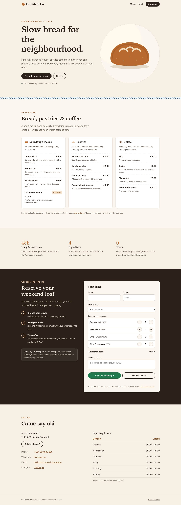
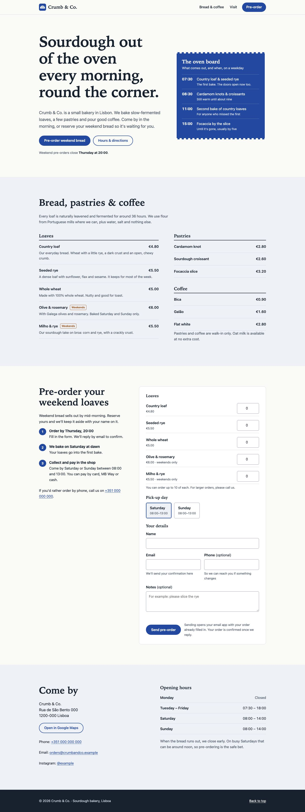

# Example: the same bakery page, without and with Web Checkup

One prompt, two isolated Claude Code runs, one attempt each. Nothing was regenerated or cherry-picked.

## Method

- **Prompt** (identical for both, see [prompt.txt](prompt.txt)): a one-page site for "Crumb & Co.", a small sourdough bakery in Lisbon, as a single self-contained `index.html`, "ready to launch".
- **Model:** Claude Opus 5.5 in Claude Code, headless (`claude -p`), on 12 October 2026.
- **Isolation:** both runs used `--setting-sources project --strict-mcp-config`, so no personal plugins, skills or MCP servers were loaded. The baseline also used `--disable-slash-commands` (no skills at all). The second run loaded only this repository with `--plugin-dir`.
- **Same tools and budget** for both: file tools, `node`, `python3`, and a $3 cap.
- **Measured** afterwards with this repo's own `scan.mjs` and `visual-check.mjs`, plus a manual look at the screenshots.
- **Only change to the published files:** invented phone numbers, emails, domain and Instagram handle were replaced with reserved placeholders (`+351 000 000 000`, `crumbandco.example`, `@example`), because generated contact details can belong to real people.

## Results

| | Without the skill | With Web Checkup |
| --- | --- | --- |
| AI-template score (`scan.mjs`) | **11 (High)** | **0 (Low)** |
| Template tells (scanner plus manual review) | Cream canvas with a clay accent, tracked uppercase labels above every section, a hand-drawn SVG bread illustration, three equal menu cards, a "48h / 4 / 0" stats row, em dashes and middle dots in UI copy | None |
| First screen on a phone (390 px) | Decorative illustration first; headline and button pushed down | Headline, explanation and both actions visible immediately |
| Tap targets under 44 px on a phone (`visual-check.mjs`) | 14 | 0 |
| Link preview (`og:image`, `twitter:card`) | Missing: shared links show a blank card | Present |
| Subject-specific design idea | Generic "artisan" look | An "oven board" of real bake times as the hero, cobalt blue echoing Lisbon's azulejo tiles, the menu as a printed price list |
| Self-verification | None: wrote the file and stopped | Ran the scanner and browser screenshots, fixed what they found, re-checked |
| Structured data, focus styles, reduced motion | Present | Present |
| `robots.txt`, sitemap | Not created (the prompt asked for one file) | Not created (same reason) |
| Cost and steps | $0.56, 5 steps | $0.98, 32 steps |

Plain Claude already gets many technical basics right. The skill's biggest effect is on the things models default to: the template look, mobile ergonomics, sharing metadata, and checking the rendered result instead of assuming it works.

## Files

- [without-skill/index.html](without-skill/index.html)
- [with-skill/index.html](with-skill/index.html)

Full-page screenshots (desktop, 1440 px)

Without the skill:

With Web Checkup:

To reproduce, run the prompt in an empty folder twice, once with the skill installed and once without, then compare the results with `scan.mjs` and `visual-check.mjs`. Model output varies between runs. Treat this as one honest sample, not a benchmark.
